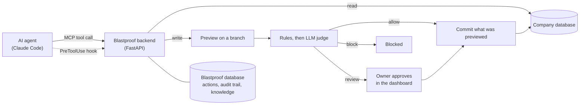

# Blastproof

**A safety gateway for AI agents.** Every tool call an agent makes passes through Blastproof.
Reads run directly. Writes are previewed on a database branch, explained in plain language, judged
by rules and an LLM, then auto-approved, blocked, or held for the owner's approval before they are
committed with an audit trail.

The agent never holds the company database's credentials, so a bad `DELETE FROM users` becomes a
held request that says "deletes 48,213 users, including 12 paying customers", not an incident.

## How it works



- **Code counts, the LLM explains.** Every number comes from the database, never from a model.
- **Fail closed.** An error, timeout or unparseable statement blocks the write.
- **The boundary is credential isolation.** Company credentials live only in the backend.

More: [`docs/spec.md`](docs/spec.md) (what and why), [`docs/backend-plan.md`](docs/backend-plan.md),
[`docs/frontend-plan.md`](docs/frontend-plan.md), [`docs/decisions.md`](docs/decisions.md).

## Quickstart (fully local: no Neon, no model key)

You need Docker, [uv](https://docs.astral.sh/uv/), Node (see `frontend/.nvmrc`) and, for the agent
part, Claude Code **v2.1.295 or newer** (older versions let a failing hook through). The full guide,
with the Neon path and troubleshooting, is [`docs/setup.md`](docs/setup.md).

```text
docker compose up -d
cd backend
uv sync
cp .env.example .env        # then fill the values listed in docs/setup.md section 3
uv run alembic upgrade head
uv run python ../demo_company/seed.py --target local
uv run python -m app.cli bootstrap --admin-email you@example.com --admin-name "You"
uv run python -m app.cli seed-demo-actions
uv run uvicorn app.main:app --reload --env-file .env --log-config log_config.json
```

The first `bootstrap` downloads a 67 MB embedding model (set `EMBEDDING_CACHE_DIR` to choose where).
Open <http://localhost:8000/docs>, log in with `POST /v1/auth/login`, and approve or reject the seeded
actions. Without a model key the summary uses a template and the judge sends writes to human review.

The dashboard (`cd frontend && npm ci && npm run dev`, <http://localhost:3000>) has login,
navigation and shared components so far; its pages are placeholders until the dashboard steps land.

## Connect Claude Code

`bootstrap` prints the agent's key once. Create a workspace that holds only that key, with the hook
installed, and start Claude Code in it (see [`claude_hook/README.md`](claude_hook/README.md)):

```text
uv run --project backend python claude_hook/workspace.py create ../blastproof-demo --key-stdin
uv run --project backend python claude_hook/workspace.py check ../blastproof-demo
```

## Development

Checks, from `backend/` and `frontend/`:

```text
uv run pytest
uv run ruff check . ../demo_company ../claude_hook
cd ../frontend && npm run lint && npm run typecheck && npm test
```

After changing a route: `uv run python -m app.cli export-openapi`, then `npm run gen:api` in
`frontend/`. CI fails if either generated file is stale. Progress and known issues:
[`PROGRESS.md`](PROGRESS.md).

> Status: backend MVP steps 1 to 20, the evals runner and the Fly.io deploy files (checklist: [`docs/deploy.md`](docs/deploy.md)) are done (`uv run python -m evals.run`, see
> [`docs/setup.md`](docs/setup.md)); the dashboard is partly built; the demo GIF and the published eval
> results table are still to come.
